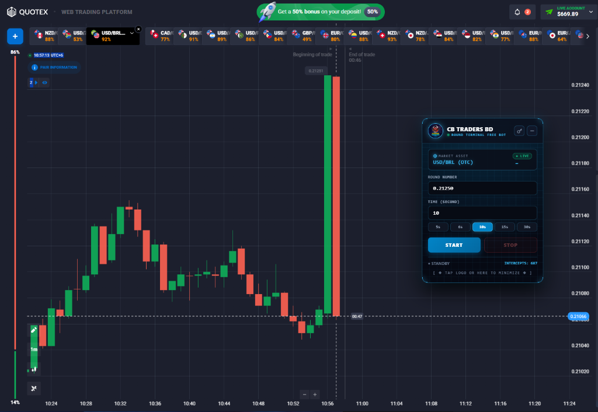

# 🎯 Quotex Round-Number Price Action & SNR Spike Tracker

> **Institutional-grade Chrome Extension (Manifest V3) & Reverse-Engineered Binary Stream & Protobuf Protocol Decoder for Quotex & Pocket Option chart terminals.**

[](https://t.me/+R_kEsY9yqkA1NDI1)
[](https://t.me/YouKnowWho_am)
[](https://api1.api.cbtradersbd.com/docs)
[](https://api1.api.cbtradersbd.com/docs)

---

---

## 🎯 Live Quotex Chart Injection & HUD Terminal

<div align="center">
  
  <p><em>Figure 3: Injected Institutional Round Number (0.21250) Support/Resistance Level Monitor on Quotex Chart.</em></p>
</div>

---

## 🚀 Key Features

- **Institutional Round-Number Levels:** Automatically identifies major (00, 50) and minor (20, 80) psychological support/resistance zones.
- **Low-Level Binary Packet Sniffer:** Non-invasive client-side hook observing raw candlestick ticks without causing UI lag or rendering slowdown.
- **Cryptographic License Gate:** Standalone offline licensing system with device fingerprinting and PIN verification.
- **High-Impact News Spike Avoidance:** Integrates with real-time economic calendars to mute signals during volatile news spikes.

---

## 📦 Extension Structure

```
quotex-round-number-snr-tracker/
├── manifest.json            # Chrome Extension Manifest V3 configuration
├── content.js               # Web page DOM & Binary Protocol Stream interceptor
├── inject.js                # In-page real-time execution context hook
├── popup.html               # HUD Control Panel interface
├── popup.js                 # LocalStorage & license management logic
├── src/
│   ├── analyzer/            # Standalone Python SNR level calculation engine
│   └── licensing/           # Cryptographic licensing portal & key generator
└── examples/
    └── standalone_stream_listener.py # CLI demonstration of live tick inspection
```

---

## 🛠️ Quickstart (Load Unpacked in Chrome)

1. Clone this repository:
   ```bash
   git clone https://github.com/cbtradersbd/quotex-round-number-snr-tracker.git
   ```
2. Open Google Chrome and navigate to `chrome://extensions/`.
3. Enable **Developer mode** in the top right.
4. Click **Load unpacked** and select the repository root folder.
5. Open Quotex (`qxbroker.com` or `market-qx.info`) to activate the HUD overlay.

---

## 🏷️ Search & Index Tags
`quotex-chrome-extension` • `round-numbers` • `support-resistance` • `quotex-bot` • `binary-options` • `protobuf-decoder` • `snr-trading` • `price-action-bot` • `quotex-signals`


---

## 🌐 CB Traders BD Ecosystem : Explore All Broker APIs & Bots

Cross-platform algorithmic trading, real-time Decrypted Sub-Millisecond Binary Feeds, and AI signal engines:

| Platform | Official Official High-Frequency Binary Protocol & REST API | Signals & Telegram Bots | Data Tools & Bridges |
| :--- | :--- | :--- | :--- |
| **Quotex** | [Quotex-API](https://github.com/cbtradersbd/Quotex-API) | [quotex-otc-signal-engine](https://github.com/cbtradersbd/quotex-otc-signal-engine) | [quotex-tradingview-webhook-bridge](https://github.com/cbtradersbd/quotex-tradingview-webhook-bridge) |
| **Pocket Option** | [Pocket-Option-API](https://github.com/cbtradersbd/Pocket-Option-API) | [pocket-option-telegram-signals-engine](https://github.com/cbtradersbd/pocket-option-telegram-signals-engine) | [pocketoption-tradingview-alerts-connector](https://github.com/cbtradersbd/pocketoption-tradingview-alerts-connector) |
| **IQ Option** | [IQ-Option-API](https://github.com/cbtradersbd/IQ-Option-API) | [iq-option-telegram-signal-bot](https://github.com/cbtradersbd/iq-option-telegram-signal-bot) | [iq-option-market-data-api](https://github.com/cbtradersbd/iq-option-market-data-api) |
| **Binolla** | [Binolla-API](https://github.com/cbtradersbd/Binolla-API) | [binolla-live-signals-bot](https://github.com/cbtradersbd/binolla-live-signals-bot) | [binolla-tradingview-webhook-bot](https://github.com/cbtradersbd/binolla-tradingview-webhook-bot) |

---

## 💼 Commercial Bot Orders & Custom Development
Need an automated browser extension, custom sniper script, or institutional license setup?
- 💬 **Direct Telegram Contact**: [@YouKnowWho_am](https://t.me/YouKnowWho_am)
- 📢 **Official Telegram Channel**: [CB Traders BD](https://t.me/+R_kEsY9yqkA1NDI1)
- 🤖 **AI Signal Bot Demo**: [https://t.me/cbsignalsproai_bot?start=1](https://t.me/cbsignalsproai_bot?start=1)
- 🛡️ **Trader Verification Bot**: [https://t.me/cbtradersbd_bot?start=1](https://t.me/cbtradersbd_bot?start=1)
- 🌐 **Interactive API Documentation**: [https://api1.api.cbtradersbd.com/docs](https://api1.api.cbtradersbd.com/docs)

---

## ⭐ Star This Project
If you find this open-source trading toolkit valuable, please give it a **Star on GitHub** to support active development!
<!-- last_verified_sync: 1793078612 -->
